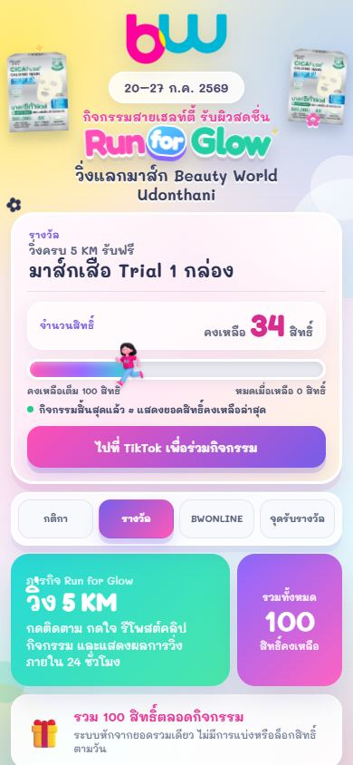
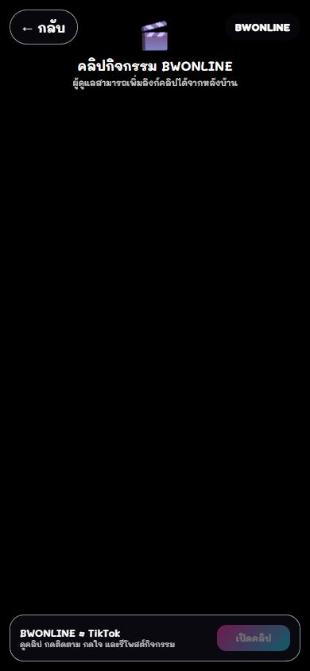
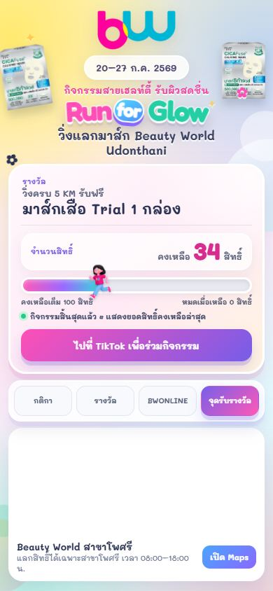
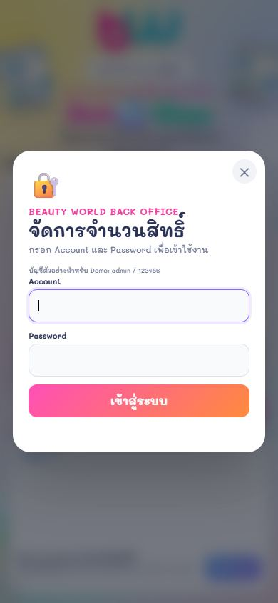
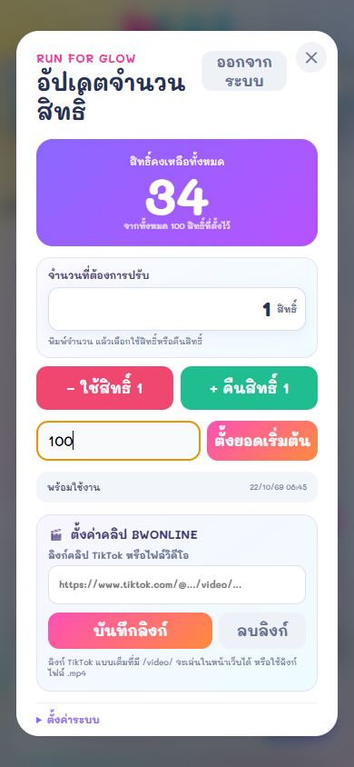
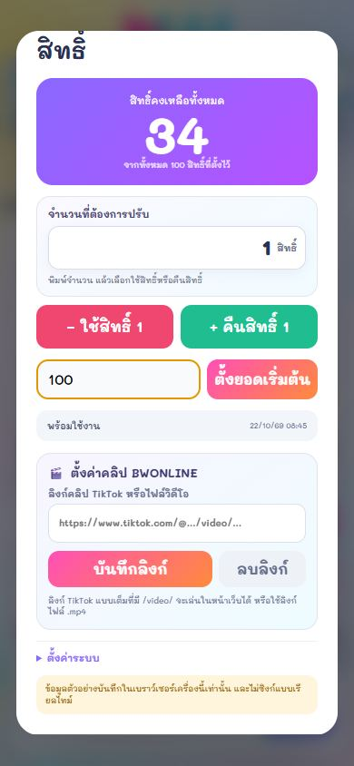

# Run for Glow — Beauty World Udonthani

หน้าเว็บกิจกรรมวิ่งสะสมระยะทาง แลกรับมาส์ก Beauty World ออกแบบสำหรับมือถือและจอสัมผัส พร้อมหน้าจัดการสิทธิ์สำหรับผู้ดูแล

**[เปิด Live Preview](https://preview--runforglowbw2026.lovable.app/?__lovable_sha=fa681285)**

> เว็บไซต์ที่ใช้งานจริงใช้ฐานข้อมูลบนคลาวด์เป็นข้อมูลกลาง เพื่อแสดงยอดล่าสุดและอัปเดตเมื่อผู้ดูแลเปลี่ยนข้อมูล ส่วนซอร์สโค้ดใน repo นี้เป็นเดโมที่ทำงานแยกบนเบราว์เซอร์ และไม่ซิงก์ข้อมูลแบบเรียลไทม์

## ภาพหน้าจอมือถือ

ภาพทั้งหมดจับจากเดโมที่ขนาดจอมือถือแนวตั้ง 390 × 844 พิกเซล

| กิจกรรมและกติกา | รางวัล |
|---|---|
|  |  |

| คลิปกิจกรรม | จุดรับรางวัล |
|---|---|
|  |  |

| เข้าสู่ระบบตัวอย่าง | จัดการสิทธิ์และคลิป |
|---|---|
|  |  |

**ตั้งค่าคลิป BWONLINE**



## ฟีเจอร์

- แสดงยอดสิทธิ์คงเหลือและแถบความคืบหน้าของกิจกรรม
- แสดงกติกา รายละเอียดรางวัล คลิปกิจกรรม และจุดรับรางวัล
- มีลิงก์เปิดตำแหน่งสาขาใน Google Maps
- หน้าจัดการตัวอย่างสำหรับตั้งยอดสิทธิ์ ใช้สิทธิ์ คืนสิทธิ์ และตั้งลิงก์คลิป
- ปรับหน้าจอสำหรับมือถือและพื้นที่กดบนจอสัมผัส
- เดโมบันทึกยอดและลิงก์คลิปใน `localStorage` ของเบราว์เซอร์เครื่องนั้น

## บัญชีสำหรับเดโม

- Account: `admin`
- Password: `123456`

บัญชีนี้เป็นเพียงตัวอย่างในเดโมฝั่งเบราว์เซอร์ ไม่ใช่ระบบยืนยันตัวตนที่ปลอดภัย และห้ามใช้กับเว็บไซต์จริง

## ทดลองบนเครื่อง

ติดตั้ง Node.js แล้วรัน:

```bash
npm install
npm run dev
```

เปิด URL ที่ Vite แสดงใน Terminal เดโมเป็นหน้าเว็บแบบ static และไม่ต้องตั้งค่า API key หรือฐานข้อมูล

## ต่อฐานข้อมูลสำหรับระบบจริง

นำหน้าจอและฟังก์ชันในเดโมไปต่อกับระบบจัดเก็บข้อมูลที่ต้องการได้ เช่น Lovable Cloud, Supabase, Firebase หรือ API ของตัวเอง แนวทางทั่วไป:

1. สร้างตารางหรือ collection สำหรับยอดสิทธิ์ ลิงก์คลิป และเวลาอัปเดต
2. เชื่อมหน้าเว็บกับ API หรือ SDK เพื่ออ่านและบันทึกข้อมูลกลาง
3. ใช้ระบบยืนยันตัวตนฝั่งเซิร์ฟเวอร์ และกำหนดสิทธิ์ให้เฉพาะผู้ดูแลแก้ข้อมูลได้
4. อัปเดตหน้าสาธารณะด้วย realtime subscription หรือ polling ตามความเหมาะสม
5. เก็บ public client key ใน environment variables และห้ามฝังรหัสผ่านผู้ดูแลหรือ secret key ไว้ในหน้าเว็บ

ผู้เริ่มต้นสามารถใช้เครื่องมือสร้างเว็บที่มีระบบฐานข้อมูลบนคลาวด์ในตัว แล้วเชื่อมหน้าจอเข้ากับตารางข้อมูลตามขั้นตอนข้างต้นได้

## หมายเหตุ

ภาพและเนื้อหาในโครงการนี้จัดทำเพื่อแสดงแนวคิดหน้าเว็บกิจกรรม Run for Glow ของ Beauty World Udonthani ลิงก์ Live Preview แสดงเวอร์ชันที่ใช้งานจริง ส่วนซอร์สโค้ดใน repo นี้เป็นเดโมในเบราว์เซอร์และแยกจากข้อมูลจริง
